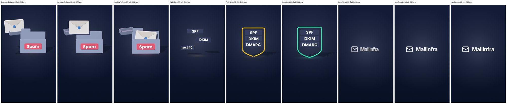
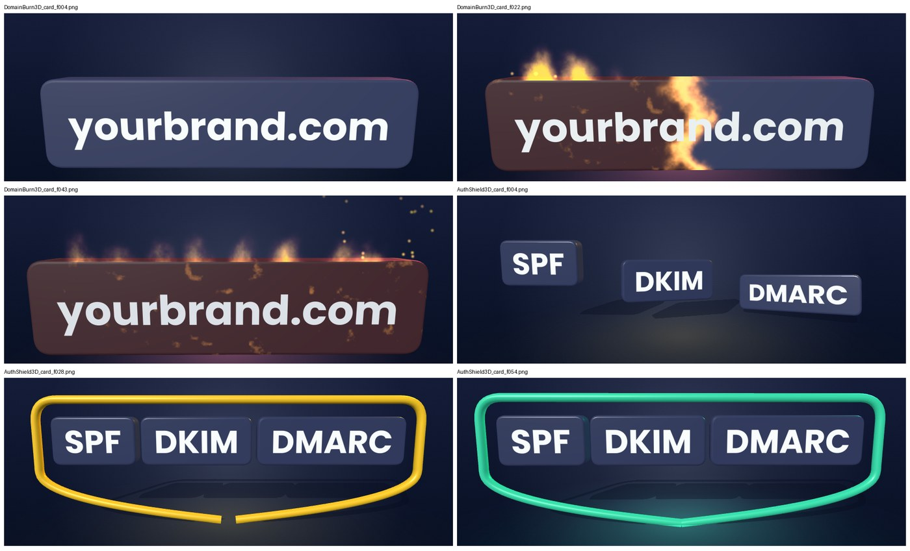
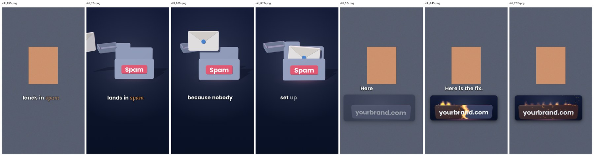
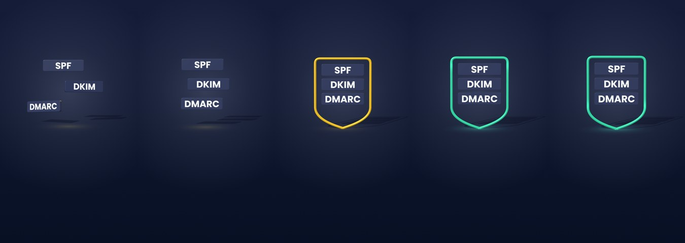
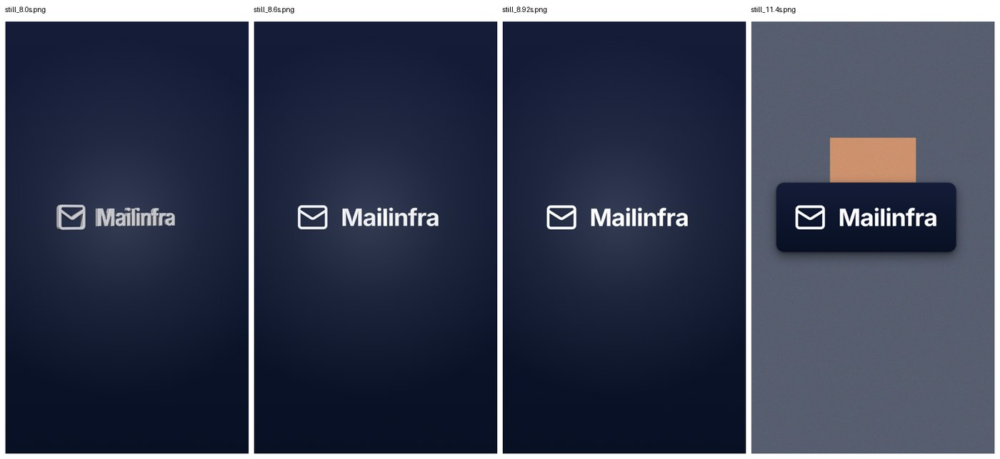
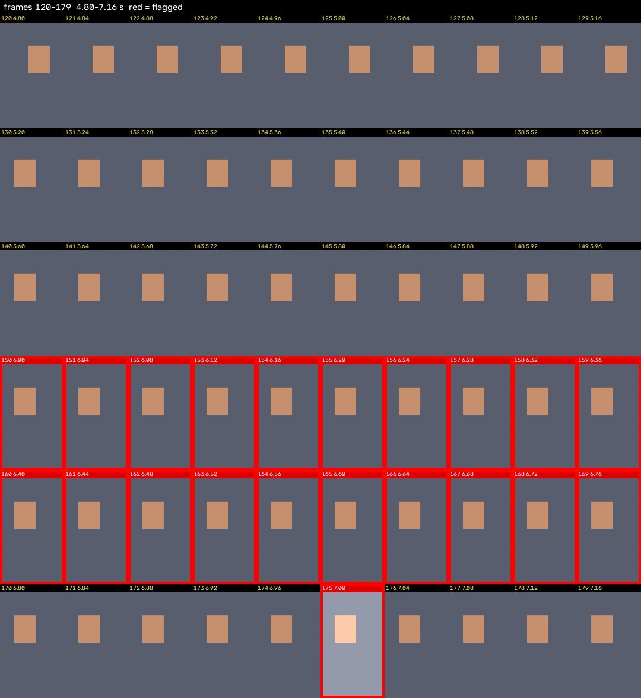
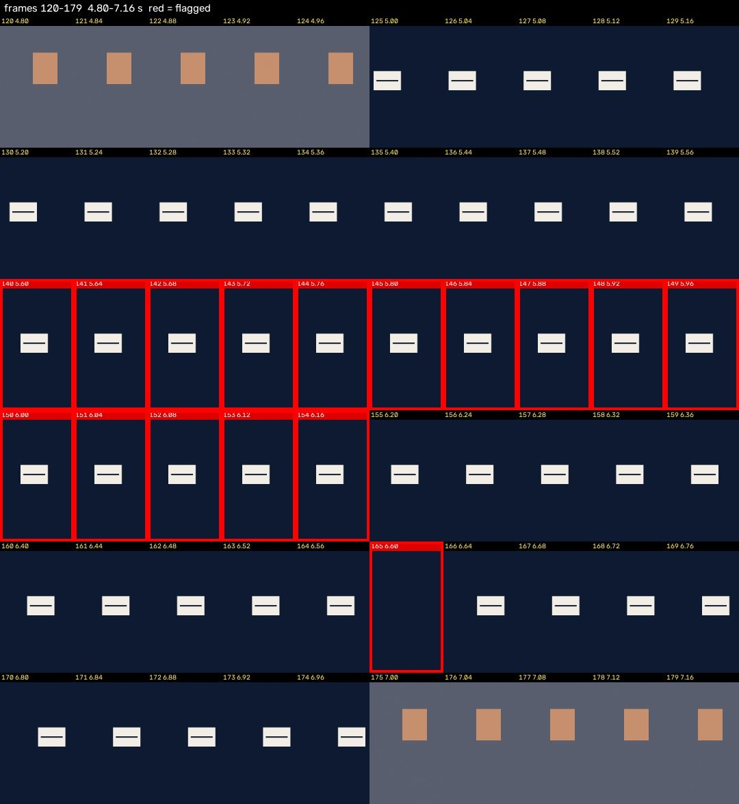
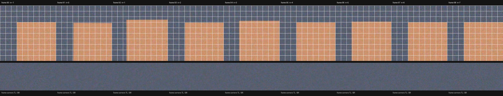

# Build log: decisions and traps

The five work items of [gaps-and-plan.md](gaps-and-plan.md) ran in parallel on disjoint files. Each one filed requests to the others as it went; this log merges those notes and the acceptance evidence into the decisions that stuck and the traps that cost time. All numbers come from the mock fixture or synthetic test videos on an 8 vCPU machine with no GPU, under `nice` and at Remotion concurrency 2.

## W1: 3D inserts (`reel-3d`)

**Result.** Four compositions (`EnvelopeToSpam3D`, `DomainBurn3D`, `AuthShield3D` in card and takeover form, `LogoExtrude3D`) plus a brand colour patch. `check3d.py` on mock props:

| Composition | Fit | Frames | Two runs identical | Still = sequence | Min frame diff | s per frame |
|---|---|---|---|---|---|---|
| EnvelopeToSpam3D | full | 34 | 34/34 | yes | 0.18 | 0.22 |
| DomainBurn3D | card | 45 | 45/45 | yes | 0.37 | 0.07 |
| AuthShield3D | card | 56 | 56/56 | yes | 0.35 | 0.07 |
| AuthShield3D | full | 36 | 36/36 | yes | 0.27 | 0.18 |
| LogoExtrude3D | full | 24 | 24/24 | yes | 0.01 | 0.19 |

Brand patches (brand blue, navy panel, danger, success, accent, cream): 0 codes off in PNG, at most 1 code per channel after the ProRes 4444 round trip. Every insert stayed under the 0.35 s per frame budget.

**Integration.** On the 12 s mock reel the takeover covers the frame on its first frame, the card sits in the card zone with captions lifted above it, insert colours pass through `VideoInsert` unchanged, a second `render3d.py` run prints `cached` for both beats, and a missing clip fails the render instead of drawing black.

**Decisions.**
- `render3d.py` needs `props.json` only for the fps (or `--fps`). Stage order: `resolve_beatmap.py`, `build_props.py`, `render3d.py`, `render.sh`.
- Event ids per composition are fixed so sound and QA can key on them: envelope `whoosh`, `land`; domain `ignite`, `burn`; shield `plate1..n`, `slide`, `lock`, `seal`; logo `turn`, `glint`, `front`.
- **`LogoExtrude3D` moved out of the end-card lead-in.** The CTA window (last 3 s before the end card) must stay on the face and the beat audit fails any 3D there, so the logo turn marks the first time the brand is named and hands off to a flat logo card. Its props (`widthPx`, `card`, `logo`, `centerY`) now mean exactly what they mean on that 2D logo card, and `centerX` was removed (centred on the safe area like the 2D card). Default `widthPx` 800 gives a 640 px mark. Composited against the 2D card, the final frame's logo mask IoU is 0.987 to 0.994.
- `AuthShield3D` as a full takeover was shortened to 1.0 to 1.5 s with the lock 0.8 to 0.9 s after the start, to fit the 1.5 s takeover limit; longer only as a card.

**Values that won** (full list in the [skill](../../skills/reel-3d/SKILL.md)):
- With a `flat` canvas, the prototype light rig (tuned under ACES tone mapping) rendered the cream envelope dull at about (166, 162, 156) and clipped top bevels. A front-biased key (3.0) and hemisphere 1.0 brought the face to about (225, 220, 210).
- The darkest brand token as the emissive of every material: unlit navy sides were (2, 2, 8) before.
- Logo bevel 0.012 world units instead of 0.03: at a 640 px mark 0.03 is 5 px, which ate most of the 12 px icon stroke and dropped the front-on mesh vs flat mark IoU to 0.83; at 0.012 it is 0.96.
- Logo side walls at 0.12 of the face colour: full-white walls made the wordmark look doubled on the turn frames, and 0.42 still ghosted.

- A seeded 1-code dither on the backdrop gradient: without it the soft spot showed rings after encoding.
- Takeover holds on a mostly empty navy frame need real motion to pass the frozen check: the tall shield went from creep 0.0015 and 1.3 degrees of sway (frame diffs 0.17 to 0.24) to 0.0025 and 2.2 degrees.
- Envelope mesh at 4 bevel segments and 10 curve segments (from 6 and 16): 0.36 down to about 0.22 s per frame with no visible change.

**Traps.**
- A text label at the same depth as its plate z-fights into a broken word; labels sit 0.05 units in front.
- `SVGLoader.createShapes` is deprecated in three 0.187; use `shapePath.toShapes()`.
- Unioning a quad per stroke segment and a disc per point gave criss-cross bevels at every logo corner; strokes are now offset into one outline per sub-path before extrusion.
- The R3F directional light target is not in the scene, so moving it does nothing; scenes are built around the origin.

## The lock deadlock (W1, W4, W3)

`render.sh` and `render3d.py` both learned to take `REEL_RENDER_LOCK` themselves. A caller that also wrapped them in `flock` on the same file (`flock "$LOCK" bash render.sh ...` with the variable exported) made the inner `flock` wait forever on the lock its own parent held. Two such runs held the shared lock for 9 minutes and blocked every other render until the inner waiters were killed.

Fix: every entry point skips its own lock when an ancestor process already holds it (it reads `/proc/locks` and compares the holder with its ancestors). Both forms are now safe; the runbook says so.

## W2: QA gates (`reel-qa`)

**Synthetic fault test.** A 10 s mock video with injected faults: every fault found at the right frame, nothing else flagged.

| Fault injected | Reported |
|---|---|
| 1 black frame at 2.00 s | FAIL, frame 50 |
| 1 white frame at 4.00 s | FAIL, frame 100 |
| 20-frame freeze from 6.00 s | frozen span 150 to 169 |
| 1-frame pop at 7.00 s | WARN, frame 175 |
| cover window over plain A-roll at 8 to 9 s | FAIL, frames 200 to 224 (max skin share 0.08 against a 0.05 limit) |

A second synthetic video exercised the graphics checks: a 15-frame freeze inside a 3D window (FAIL), one uniform 3D frame (luma std under 0.01, FAIL), two empty entrance frames, one caption page ending 1 frame after a cut, and an accent word at 1.89:1 contrast over a bright area (WARN). All reported. The frames gate took 4 to 6 s on 8 to 10 s videos.

**Decisions and notes to other items.**
- **Handoffs, not just entrances.** The frames gate flagged a frame of bare A-roll or a blank panel where one card beat hands over to the next in the same zone. Sampling entrances one frame in fixes the "late" case; a handoff also needs the next beat to draw on the frame the previous one stops.
- **Held frames in the EDL.** When a range holds its last frame and the next range starts at that same source time, the held frame repeats once more and motion resumes with a jump: an unplanned pop. Start the next range one frame later or end the hold one frame earlier.
- Planned dropouts come from `qa/mix_report.json` (`dropouts: [{start, end}]`), so the mix must write its report there.
- The critic score table header is fixed (C8), and a pass stops the loop when it has no BLOCKER or MAJOR rows and its mean did not rise.
- For 3D: the gate FAILs a 3D window that holds still for 12+ frames (mean grey diff under 0.25 at 180x320) or shows a uniform frame. A slow rotation of a small object can fall under 0.25: keep motion in every frame or end the insert.
- The frozen threshold is 0.25, not the plugin's 0.02: a talking-head hold with a slow creep and sensor noise sits between those values.

## W3: director, runbook, research tools

**Results.**
- Beat audit on the acceptance beat map (3D card at 0.5 s, takeovers at 6.0 and 16.0 s, an uncovered cover window at 20.0 to 20.4 s) printed exactly: FAIL cover, FAIL 3D before 1.0 s, WARN two 3D takeovers within 15 s.
- The mock pipeline (`make_mock_reel.py` 18 s, then `new_reel.sh`, `resolve_beatmap.py`, `plan_camera.py`, `build_props.py`, `beat_audit.py`, `beat_sheet.py`, `status.py`) ran end to end; `status.py` named the next command.
- `measure_reference.py` on a synthetic video (hold, a 12 px/f smootherstep pan, a cut, a 0.2 %/f push, a cut) found both cuts, one move with an 11.8 px/f peak and a 0.187 %/f push, in 1.9 s for 200 frames.
- Doc lint: one miss while the 3D skill was still in progress (its link), cleared when it landed.

**Decisions.**
- `status.py` calls a 3D clip STALE when composition, timing, fps, frames, `src` or the resolved insert props differ from `3d/<beat>.json`, or when the 3D source tree or brand file is newer. Storing the resolved props in that json lets status compare without re-implementing the render hash.
- The 3D budget in `beat_audit.py`: FAIL a 3D beat before 1.0 s or overlapping the last 3 s before the end card (except a beat starting after the A-roll ends); WARN more than one takeover in 15 s, a takeover over 1.5 s, or 3D time outside 4 to 8 s per 60 s. Kick keys copy the current state, so audits count them as kicks, not scale changes.
- Event cues may carry `event_offset` for a per-cue shift.

## W4: camera, time rule, captions

**Results.**
- **Kick** on the mock fixture: centre offsets +2.4/+3.9, -1.8/-3.1, +1.3/+2.4, -1.0/-1.8, +0.6/+1.1, -0.4/-0.6, +0.1/+0.2, then 0 px, roll +0.18 to -0.002 degrees, scale raised to at most 1.012 so no edge shows.

- **Creep floor**: a 3 s shot over a static textured wall at 180x320. Auto creep 0.06: longest run under the 0.25 frozen threshold is 8 frames (passes). No creep: 74 frames (frozen). The old 0.03 token: 15 frames (frozen). So the old creep read as a held frame and 0.06 became the default.
- **Peak speeds** printed per move at the frame corner: an 8-frame +0.05 push peaks at 31.8 px/f, an 18-frame 0.06 glide at 6.8, a 7-frame kick at 15.0, a creep at 1.3 to 1.6.
- **Entrance frames**: before the fix, the frame-0 difference inside the zone was as low as 0.55 to 0.61 (empty); after, 7.98 to 72.97 for the fixed components. A few components still read "blank" to the gate because they start sparse over a flat mock wall or draw outside the card box: zone effects, not empty entrances.
- **Time rule**: an anchored `ShieldSeal` rendered the same md5 on three frames as the absolute version. `build_props.py` rejects a props time outside -0.5 s to the beat length with a message naming the beat and key.
- ASR chunking: 24 synthetic reels, no chunk bound inside a word (the old rule put 9 inside a word). Caption tests: 13 pages, cut snap and page options.
- A full 12 s mock render: 79 s wall, 300 frames as planned, 0.86 GB peak memory.

**Decisions and traps.**
- Caption options are written as `captions` in the beat map source and stored as `props.captionOptions`, because `captions` in props was already the word list.
- Every time inside `beats[].props` is beat-relative; `props.three`, `topLogo` and `accents` stay absolute. Templates with absolute numbers inside props had to switch to anchors or `{"@rel": seconds}`.
- Builder acceptance stills include `from + 0`.
- **Auto creep cascade.** The first auto-creep pass ran after the forced-punch rule (consecutive cuts must change scale by at least 0.03) and pushed scales up cut after cut, to 1.17. Running creep before the rule and letting a forced cut step down as well as up kept the scales near their planned values. When most cuts are forced, the planner now says the clip states do not alternate enough.
- A kick on a shot at scale 1.0 has no edge headroom; the renderer raises the scale for the kick frames and the planner warns. Two kicks under 3 s apart also warn.
- Planned camera events for QA: glide windows centred on `t`, kick windows `t` to `t + frames/fps`, auto creeps one frame after a cut.

## W5: sound, cut, voice

**Decisions.**
- `qa/mix_report.json` has a top-level `dropouts` list and a `bed_events` list with kinds `duck`, `impact dip`, `bed dip`, `ride`, `dropout`, `lift`, `tail fade`, `voice gain`, `room tone`.
- `mix.py` exits 2 on a stale voice (lines starting `VOICE GUARD:`) as well as on a failed loudness gate.
- `--duck-mode words` is the default and needs `--words`; `sidechain` is the fallback.
- `sfx_cues.py --events` reads the 3D event files exactly as `render3d.py` writes them.
- The generated SFX kit is a fallback only when no vetted CC0 kit is at hand.

**Result.** With the generated kit, LU levelling put every SFX cue on its class target in the final mix (impacts -8, whooshes -17, pops -14, a 3D glint -16, riser -18, tone -20 LU against the voice), well inside the 1 LU acceptance limit, and the cue sheet lists every cue with its measured level next to every duck, ride, dropout and room-tone fill. The same seed gives byte-identical SFX files.

## Lessons for the next parallel build

- Write contracts first (event ids, time conventions, file shapes, env vars) and keep them in one table; most cross-item requests were contract clarifications.
- One owner per file meant zero merge conflicts across five builders.
- Shared resources (the render lock, CPU) need a rule that survives nesting, not a convention.
- Every QA threshold was tested twice: once on synthetic faults (must be found) and once on real renders (must stay quiet).
